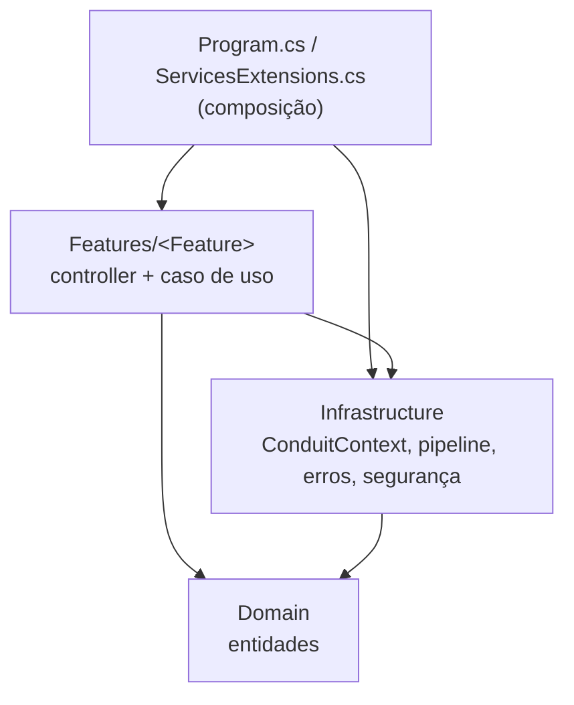

# ADR-001 — Vertical slices por feature na API

- **Status:** aceita (retroativa). Decisão herdada do Conduit, registrada a partir do código `api` no commit `faa728c`.
- **Abrangência:** API inteira; vale para as features F01 a F07 de artigos.
- **Relacionadas:** [ADR-002](ADR-002-validacao-no-pipeline-do-mediator.md), [ADR-003](ADR-003-transacao-por-comando.md), [ADR-004](ADR-004-persistencia-direta-com-ef-core.md).

## Contexto

A API é um único projeto .NET (`api/src/Conduit/Conduit.csproj`). Ela não é separada em projetos por camada.

## Decisão

O código é organizado por funcionalidade, não por camada técnica:

- Cada área funcional fica numa pasta `api/src/Conduit/Features/<Feature>/` (`Articles`, `Comments`, `Favorites`, `Followers`, `Profiles`, `Tags`, `Users`).
- Cada caso de uso é **uma classe por arquivo** (`Create`, `Details`, `Edit`, `Delete`, `List`, `Add`, `Login`). Ela aninha o `Command` ou `Query`, os validators e o `Handler` (`api/src/Conduit/Features/Articles/Create.cs:15-106`: dados e validators em `:17-44`, handler em `:46-105`).
- O controller da feature é fino: monta o request e chama `IMediator.Send`, sem regra de negócio (`api/src/Conduit/Features/Articles/ArticlesController.cs:11-65`).
- O código transversal fica em `Infrastructure/`, as entidades ficam em `Domain/`, e a composição de dependências fica na raiz (`api/src/Conduit/ServicesExtensions.cs:70-91`, `api/src/Conduit/Program.cs:12-97`).

## Regras de dependência observadas

| Quem | Depende de | Não depende de | Evidência |
|---|---|---|---|
| `Domain` | Só `System.*` | Nenhum namespace `Conduit.*` | `api/src/Conduit/Domain/Article.cs:1-5` (os outros arquivos de `Domain/` seguem igual) |
| `Infrastructure` | `Domain` | `Features` (nenhum `using Conduit.Features` em `Infrastructure/`) | `api/src/Conduit/Infrastructure/ConduitContext.cs:7-8` |
| `Features/<X>` | `Domain`, `Infrastructure` e, pontualmente, outra feature | — | `api/src/Conduit/Features/Articles/Create.cs:6-8` |

Referências entre features existem hoje e são pontuais:

| De | Para | O que usa | Evidência |
|---|---|---|---|
| `Favorites` | `Articles` | `ArticleEnvelope` como resposta | `api/src/Conduit/Features/Favorites/Add.cs:5`, `:16` |
| `Articles` | `Profiles` | `Profile` no `ArticleSummary` | `api/src/Conduit/Features/Articles/ArticleSummary.cs:3`, `api/src/Conduit/Features/Articles/List.cs:5` |
| `Followers` | `Profiles` | `IProfileReader` | `api/src/Conduit/Features/Followers/Add.cs:5`, `:26` |

## Consequências

- Uma mudança num caso de uso fica concentrada num arquivo. O caso de uso é o handler: não há camada Application separada.
- Nenhum teste de arquitetura verifica essas regras de dependência. Elas valem por convenção (nenhum teste desse tipo foi encontrado em `api/tests/`).
- A política `api/AGENTS.md` ("Controllers finos; passe o `CancellationToken` da requisição até handlers e chamadas ao banco") formaliza este padrão.
